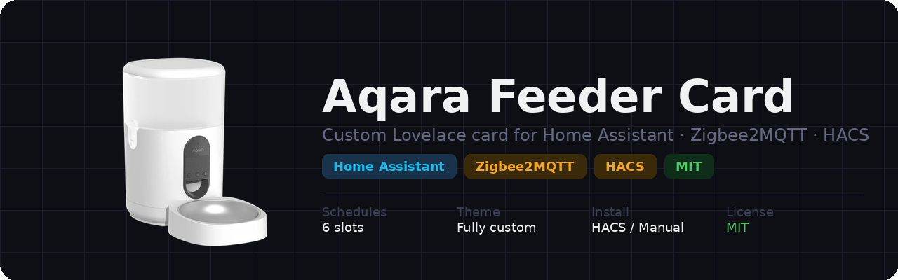
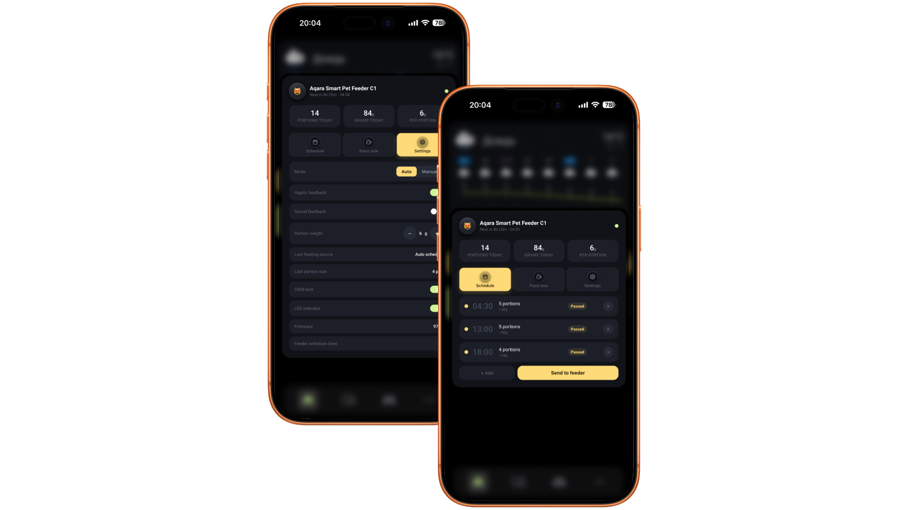
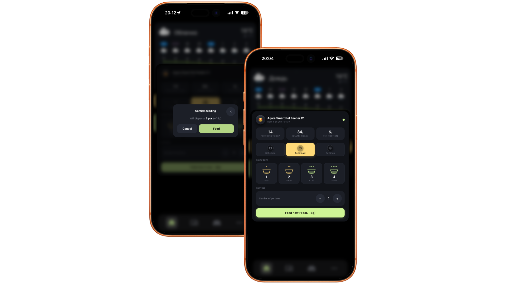

# Aqara Feeder Card

<p align="center">
  
</p>

<p align="center">
  A custom Lovelace card for <strong>Home Assistant</strong> to control an Aqara pet feeder (and compatible Zigbee feeders) via <a href="https://www.zigbee2mqtt.io/">Zigbee2MQTT</a>.
</p>

<p align="center">
  <a href="https://github.com/hacs/integration"></a>
  <a href="https://github.com/badbadtrip/aqara-feeder-card/releases"></a>
  <a href="https://github.com/badbadtrip/aqara-feeder-card/stargazers"></a>
  <a href="https://github.com/badbadtrip/aqara-feeder-card/issues"></a>
  <a href="LICENSE"></a>
</p>

---

<p align="center">
  <a href="#installation">Installation</a> &bull;
  <a href="#configuration-reference">Configuration</a> &bull;
  <a href="#full-yaml-example">Full example</a> &bull;
  <a href="#troubleshooting">Troubleshooting</a> &bull;
  <a href="#contributing">Contributing</a>
</p>

---

## Features

- **Schedule tab** — view, add, edit and delete feeding schedules; send directly to the feeder via MQTT
- **Feed now tab** — quick 1–6 portion buttons + custom stepper with confirmation popup
- **Settings tab** — portion weight, child lock, LED indicator, operating mode, firmware version
- **Stats bar** — portions today, grams today, grams per portion
- **Full color theming** — 7 configurable colors (accents + backgrounds)
- **Custom labels** — all UI text is overridable
- **Haptic feedback** — optional vibration on mobile
- **Live status** — animated online/offline dot, error badge, schedule text in header
- **Visual config UI** — no YAML required

## Screenshots

<p align="center">
  
</p>
<p align="center">
  
</p>

## Requirements

| Requirement | Details |
| --- | --- |
| Home Assistant | 2023.1 or newer |
| Zigbee2MQTT | Any recent version |
| MQTT integration | Configured in HA |
| Feeder | Aqara Pet Feeder C1 / E1 or compatible Zigbee feeder |

---

## Installation

<details>
<summary><b>Via HACS (recommended)</b></summary>

<br>

1. Open **HACS** → **Frontend**
2. Click the three-dot menu → **Custom repositories**
3. Enter URL: `https://github.com/badbadtrip/aqara-feeder-card`, Category: **Dashboard**
4. Click **Download**
5. Reload your browser

</details>

<details>
<summary><b>Manual</b></summary>

<br>

1. Copy `aqara-feeder-card.js` to `/config/www/`
2. Go to **Settings → Dashboards → Resources**
3. Add resource: URL `/local/aqara-feeder-card.js`, type: **JavaScript module**
4. Reload your browser

</details>

### Adding the card

1. В Home Assistant откройте панель в режиме редактирования, нажмите **Добавить карточку** и найдите **Кормушка Aqara**.
2. В разделе **Основные настройки** выберите устройство в списке **Кормушка Zigbee2MQTT**. Если карточка новая и найдена одна кормушка с расписанием, размером порции и данными о последнем кормлении, редактор выберет её автоматически.
3. Проверьте **MQTT topic для команд** и сохраните карточку. Редактор подставляет `zigbee2mqtt/<friendly_name>/set` и сопоставляет доступные MQTT-сущности кормушки. Если вы меняли базовый topic или имя в Zigbee2MQTT, укажите фактический адрес вручную.

Если кормушки нет в списке, проверьте, появилось ли устройство в MQTT-интеграции Home Assistant. При частичном сопоставлении откройте нужные разделы **Сущности** и выберите доступные сущности вручную. Те же поля доступны при ошибке чтения реестров. Для ручной настройки укажите topic, сущность расписания и число порций для ручного кормления. Остальные сущности добавляйте по мере необходимости.

При выборе другой кормушки редактор заменяет устройство, MQTT topic и поля автоподбора сущностей за одно изменение. Поля без сопоставления очищаются. Если сохранённый вручную topic (в том числе с нестандартным префиксом) или сущность отличаются от данных выбранной кормушки, редактор запросит подтверждение. Это также относится к старым конфигурациям без `device_id`. При отмене конфигурация и выбор кормушки сохраняются целиком.

После выбора MQTT topic и сущности можно править вручную. Повторный выбор текущей кормушки сохраняет эти правки. При снятии выбора очищаются поля, совпадающие с данными прежней кормушки, а ручные значения сохраняются. Заголовок, подписи и дополнительные датчики, которые задаются вручную, сохраняются при выборе кормушки.

Пример минимальной настройки через YAML:

```yaml
type: custom:aqara-feeder-card
title: Feed the cat
icon: 🐱
topic: zigbee2mqtt/Feeder/set
```

---

## Configuration reference

<details>
<summary><b>General options</b></summary>

<br>

| Key | Type | Default | Description |
| --- | --- | --- | --- |
| `title` | string | `Кормушка` | Card title |
| `icon` | string | `🐱` | Emoji or image path, e.g. `/local/images/cat.png` |
| `topic` | string | `zigbee2mqtt/Feeder/set` | Default for existing configs with this field omitted. New visual cards fill the topic from the selected feeder. |
| `max_schedules` | number | `6` | Maximum number of schedule slots |
| `vibration_enabled` | boolean | `true` | Haptic feedback on mobile |

</details>

<details>
<summary><b>Labels (all optional)</b></summary>

<br>

| Key | Default |
| --- | --- |
| `label_schedule` | `Расписание` |
| `label_feed` | `Покормить` |
| `label_settings` | `Настройки` |
| `label_portions_today` | `Порций сегодня` |
| `label_grams_today` | `Граммов сегодня` |
| `label_per_portion` | `Вес порции` |
| `label_status_passed` | `Прошло` |
| `label_status_next` | `Следующее` |
| `label_status_pending` | `Ожидается` |

</details>

<details>
<summary><b>Colors (all optional — any valid CSS color value)</b></summary>

<br>

| Key | Default | Used for |
| --- | --- | --- |
| `color_accent` | `rgb(255,218,120)` | Active tab, Save/Apply buttons |
| `color_positive` | `rgb(206,245,149)` | Online dot, Feed now button |
| `color_danger` | `rgb(255,145,138)` | Error badge, delete button |
| `color_warning` | `rgb(255,181,129)` | Reserved accent color |
| `color_card_bg` | `#111318` | Card background |
| `color_block_bg` | `#1c1f27` | Stats tiles, list rows, popups |
| `color_block_bg2` | `#262a35` | Buttons, inputs, hover states |

</details>

<details>
<summary><b>Entities</b></summary>

<br>

Entity IDs are created automatically by Zigbee2MQTT when the feeder is paired.  
Find them at **Settings → Devices & Services → Zigbee2MQTT → your feeder**.

| Key | Default | Source |
| --- | --- | --- |
| `entity_schedule` | `sensor.feeder_schedule` | Auto (Z2M) |
| `entity_schedule_pretty` | _(empty)_ | Optional |
| `entity_portions_day` | `sensor.feeder_portions_per_day` | Auto (Z2M) |
| `entity_weight_day` | `sensor.feeder_weight_per_day` | Auto (Z2M) |
| `entity_portion_weight` | `number.feeder_portion_weight` | Auto (Z2M) |
| `entity_serving_size` | `number.feeder_serving_size` | Auto (Z2M) |
| `entity_feeding_source` | `sensor.feeder_feeding_source` | Auto (Z2M) |
| `entity_feeding_size` | `sensor.feeder_feeding_size` | Auto (Z2M) |
| `entity_mode` | `select.feeder_mode` | Auto (Z2M) |
| `entity_child_lock` | `switch.feeder_child_lock` | Auto (Z2M) |
| `entity_led` | `switch.feeder_led_indicator` | Auto (Z2M) |
| `entity_error` | `binary_sensor.feeder_error` | Auto (Z2M) |
| `entity_update` | `update.feeder` | Auto (Z2M) |

</details>

---

## No extra sensors needed

The feeder's controls, schedule, portions today and grams today use entities created by Zigbee2MQTT. You don't need template sensors, `history_stats` or helpers to use the card.

Optional extras:

- `entity_food_level`: any 0–100 % sensor, shown as a food-level bar in the header.
- `entity_schedule_pretty`: header text used only while the feeder schedule is unavailable. Older versions of this card required it. Existing configs keep working.

---

## Full YAML example

<details>
<summary>Click to expand</summary>

<br>

```yaml
type: custom:aqara-feeder-card
title: Whiskers
icon: /local/images/cat.png
topic: zigbee2mqtt/Feeder/set
max_schedules: 6
vibration_enabled: true
color_accent: "rgb(255,218,120)"
color_positive: "rgb(206,245,149)"
color_danger: "rgb(255,145,138)"
color_warning: "rgb(255,181,129)"
color_card_bg: "#111318"
color_block_bg: "#1c1f27"
color_block_bg2: "#262a35"
label_schedule: Schedule
label_feed: Feed now
label_settings: Settings
label_portions_today: Portions today
label_grams_today: Grams today
label_per_portion: Per portion
label_status_passed: Passed
label_status_next: Next
label_status_pending: Pending
entity_schedule: sensor.feeder_schedule
entity_portions_day: sensor.feeder_portions_per_day
entity_weight_day: sensor.feeder_weight_per_day
entity_portion_weight: number.feeder_portion_weight
entity_serving_size: number.feeder_serving_size
entity_feeding_source: sensor.feeder_feeding_source
entity_feeding_size: sensor.feeder_feeding_size
entity_mode: select.feeder_mode
entity_child_lock: switch.feeder_child_lock
entity_led: switch.feeder_led_indicator
entity_error: binary_sensor.feeder_error
entity_update: update.feeder
```

</details>

---

## Finding the MQTT topic

Open Zigbee2MQTT → **Devices** → find your feeder. The friendly name is used in the topic:

```text
zigbee2mqtt/<friendly_name>/set
```

Example — if the friendly name is `Feeder`:

```text
zigbee2mqtt/Feeder/set
```

---

## Troubleshooting

<details>
<summary><b>Card doesn't appear in the card picker</b></summary>

<br>

1. Make sure the resource is registered: **Settings → Dashboards → Resources** — you should see `/local/aqara-feeder-card.js` with type **JavaScript module**.
2. Do a hard reload of the browser (`Ctrl+Shift+R` / `Cmd+Shift+R`).
3. Clear browser cache and try again.

</details>

<details>
<summary><b>Stats bar shows 0 / unknown</b></summary>

<br>

Both values come straight from Zigbee2MQTT (`portions_per_day`, `weight_per_day`), so nothing has to be created in HA. If they show `-`:

- Check that the entities in the card config match your feeder: **Settings → Devices & Services → Zigbee2MQTT → your feeder**.
- The feeder reports them after its next feeding. Right after pairing or a Z2M restart they can be `unknown` until then.

</details>

<details>
<summary><b>Schedule is not sent to the feeder</b></summary>

<br>

- Check that `topic` in your card config matches the MQTT set topic exactly: `zigbee2mqtt/<friendly_name>/set`.
- Open Zigbee2MQTT → **Devices** → your feeder → **Exposes** — the `schedule` field should appear there.
- Go to **Developer Tools → MQTT** and manually publish a test message to the topic to verify the broker is reachable.

</details>

<details>
<summary><b>Feeder shows as offline</b></summary>

<br>

- The online/offline state comes from the Zigbee2MQTT availability topic. Check that **Availability** is enabled in Z2M settings (`availability: true` in `configuration.yaml`).
- If the feeder was recently paired, try restarting Zigbee2MQTT.

</details>

<details>
<summary><b>Feeder doesn't dispense on schedule</b></summary>

<br>

Check the feeder **mode**. In `manual` mode the feeder ignores its schedule completely: the schedule is still listed, but nothing gets dispensed. The card shows a **Schedule is paused** banner on the Schedule tab in this case. Tap **Turn on**, or set `select.feeder_mode` to `schedule`.

</details>

---

## Contributing

Issues and pull requests are welcome.

**Before opening a PR:**
1. Open an issue first to discuss the change — this avoids wasted effort on PRs that won't be merged.
2. Run the local mocks and bundle checks below.
3. If you're changing the card UI, include a screenshot in the PR description.

**Local development:**

The source lives in `src/` as small vanilla-JS modules. [esbuild](https://esbuild.github.io/) bundles them into the single `aqara-feeder-card.js` that HACS and Home Assistant load. **Don't edit `aqara-feeder-card.js` by hand.** Edit `src/`, rebuild, and commit both. CI fails if the bundle is out of date.

```bash
npm ci
node --test test/feeder.test.js
npm run build
npm run check
git diff --check
```

Моки проверяют визуальный редактор, реестры и параметры команд локально, без Home Assistant и MQTT. Для проверки устаревшего bundle измените строку интерфейса в `src/` и запустите `npm run check` до пересборки. Ожидаемый код выхода — `1`. После `npm run build` ожидается `0`.

| Path | What's inside |
| --- | --- |
| `src/index.js` | Entry point: registers the custom elements |
| `src/defaults.js` | Default config |
| `src/card/card.js` | Card lifecycle, layout, tab switching |
| `src/card/state.js` | Schedule state, MQTT publishing, feeding |
| `src/card/header.js` | Header, status, countdown, stats row |
| `src/card/tabs/*.js` | Schedule / Feed now / Settings tabs |
| `src/card/dialogs.js` | Feed confirmation and schedule-slot editor |
| `src/card/feedback.js` | Vibration, sound, snackbar |
| `src/card/styles.js` | Card CSS |
| `src/editor/*` | Visual config editor |

[](https://github.com/badbadtrip/aqara-feeder-card/issues)

---

## License

[MIT](LICENSE)
